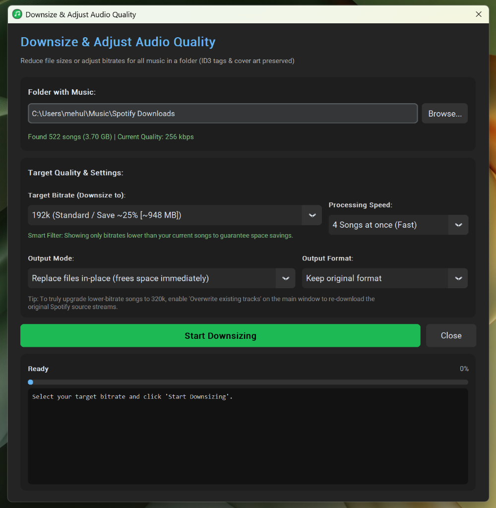

# Spotify Downloader

A fast, modern desktop application and CLI that downloads Spotify playlists, albums, or individual tracks — with full ID3 metadata and high-resolution album art embedded.

<p align="center">
  
</p>

---

## 1-Line Quick Install

Install and launch **Spotify Downloader** with a single command:

### Windows (PowerShell)
```powershell
irm https://raw.githubusercontent.com/mehuljain866/spotify-dl/main/install.ps1 | iex
```

### macOS / Linux (Terminal)
```bash
curl -fsSL https://raw.githubusercontent.com/mehuljain866/spotify-dl/main/install.sh | bash
```

---

## Single-File Standalone Downloads (No Python Required)

Prefer a portable single-file app without installing Python? Download from [**Latest Releases**](https://github.com/mehuljain866/spotify-dl/releases/latest):

| Platform | File | How to Run |
|----------|------|------------|
| **Windows** | `Spotify-Downloader-Windows.exe` | Double-click to run directly |
| **Linux** | `Spotify-Downloader-Linux` | `chmod +x Spotify-Downloader-Linux && ./Spotify-Downloader-Linux` |
| **macOS** | `Spotify-Downloader-macOS.zip` | Unzip and open `Spotify Downloader.app` |

---

## Features

- **Blazing Fast Parallel Downloads**: Download up to 4 or 6 songs at the same time concurrently for up to 5x faster downloads. Configurable in the GUI and CLI.
- **Simple & Clean UI**: Enter or paste a link, pick your folder, choose your download speed, click **Start Download**, and watch real-time progress.
- **Desktop Shortcut**: Double-click the **Spotify Downloader** icon on your Desktop to launch directly without opening a terminal.
- **Unlimited Playlist Length**: Handles playlists with 100, 200, 500+ tracks automatically without capping or truncation.
- **Smart Incremental Sync**: Use the same folder again and again. If your playlist has 150 songs and you add 5 new ones, it skips the 145 existing songs in seconds and downloads only the 5 new ones.
- **Audio Downsizing & Storage Optimizer**: Downsize existing music files to 128k, 160k, or 192k to save massive storage space (up to 60% reduction) while preserving 100% of ID3 metadata and album art.
- **Embedded High-Resolution Album Art**: Injects 640×640 album artwork directly into every audio file.
- **Complete ID3 Tags**: Title, Lead Artist, Contributing/Featured Artists, Album, Track Number, Disc Number, and Release Date intact. Widely compatible with Windows Explorer, VLC, iTunes, Apple Music, and mobile players.
- **Zero Configuration**: No Spotify API key, developer account, or login required.

---

## Running the Desktop App

1. **From your Desktop**: Double-click the **Spotify Downloader** shortcut.
2. **From Terminal**:
   ```powershell
   python gui.py
   ```

---

## Running via Command Line (CLI)

```powershell
# Download a playlist to a folder:
python spotify_dl.py https://open.spotify.com/playlist/<id> -o "C:\Music\MyPlaylist"

# Download with 4 parallel threads (default is 4x speed):
python spotify_dl.py https://open.spotify.com/playlist/<id> -o "C:\Music\MyPlaylist" --threads 4

# Incremental update (skips all existing tracks and downloads only new additions):
python spotify_dl.py https://open.spotify.com/playlist/<id> -o "C:\Music\MyPlaylist"

# Download a single track:
python spotify_dl.py https://open.spotify.com/track/4cOdK2wGLETKBW3PvgPWqT -o "C:\Music"

# Downsize all songs in a folder to save storage (e.g. 192k or 128k):
python spotify_dl.py --downsize "C:\Music\MyPlaylist" --bitrate 192k
```

### CLI Options

| Flag | Description | Default |
|------|-------------|---------|
| `-o`, `--output` | Destination folder for downloads | `~/Music/Spotify Downloads` |
| `-t`, `--threads` | Number of parallel song downloads | `4` |
| `--format` | Output audio format (`mp3`, `m4a`, `flac`, `opus`, `wav`) | `mp3` |
| `--bitrate` | Audio bitrate (`128k`, `160k`, `192k`, `256k`, `320k`) | `320k` |
| `--force` | Re-download songs even if already present | `False` |
| `--limit` | Limit download to first N tracks | `None` (all) |
| `--downsize` | Downsize/transcode all songs in a folder to target bitrate | `None` |

---

## Downsizing and Audio Quality Adjustment

If your music library occupies too much storage space (e.g. downloaded at 320 kbps), you can easily downsize your existing music files:

<p align="center">
  
</p>

1. **In the Desktop App**:
   - In the **Download Folder** card, click **Downsize / Adjust Audio Quality in Folder...**.
   - The app automatically inspects the actual encoding of all songs in the folder and presents only valid, reducible bitrate options along with calculated storage savings (e.g. `192k saves ~25% [~948 MB]`, `128k saves ~50% [~1.85 GB]`).
   - Select whether to replace files in-place or output to a separate subfolder.
   - Click **Start Downsizing** — all album art, ID3 tags, and artist info are preserved intact.

2. **In the Terminal (CLI)**:
   ```powershell
   python spotify_dl.py --downsize "C:\Users\mehul\Music\Spotify Downloads" --bitrate 192k
   ```

> **Note on Upgrading Audio Quality**: Re-encoding lower-bitrate audio files to higher bitrates cannot restore lost frequencies. To truly upgrade lower-bitrate tracks to pristine 320 kbps, check **Overwrite existing tracks (force re-download)** in the main window and click **Start Download** — Spotify Downloader will re-fetch the original 320k source streams directly from Spotify.
