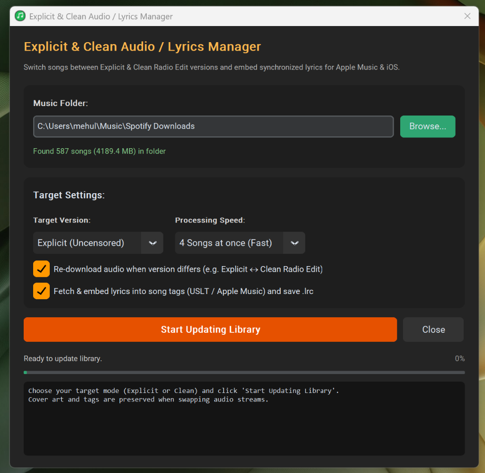

# Spotify Downloader

A fast, modern desktop application and CLI that downloads Spotify playlists, albums, or individual tracks — with full ID3 metadata, high-resolution album art, and synchronized lyrics embedded.

<p align="center">
  
</p>

---

## 1-Line Quick Install

Install and launch **Spotify Downloader** with a single command:

### Windows (PowerShell)
```powershell
irm https://raw.githubusercontent.com/mehuljain866/spotify-dl/main/install.ps1 | iex
```

### macOS / Linux (Terminal)
```bash
curl -fsSL https://raw.githubusercontent.com/mehuljain866/spotify-dl/main/install.sh | bash
```

---

## Single-File Standalone Downloads (No Python Required)

Prefer a portable single-file app without installing Python? Download from [**Latest Releases**](https://github.com/mehuljain866/spotify-dl/releases/latest):

| Platform | File | How to Run |
|----------|------|------------|
| **Windows** | `Spotify-Downloader-Windows.exe` | Double-click to run directly |
| **Linux** | `Spotify-Downloader-Linux` | `chmod +x Spotify-Downloader-Linux && ./Spotify-Downloader-Linux` |
| **macOS** | `Spotify-Downloader-macOS.zip` | Unzip and open `Spotify Downloader.app` |

---

## Features

- **Blazing Fast Parallel Downloads**: Download up to 4 or 6 songs at the same time concurrently for up to 5x faster downloads. Configurable in the GUI and CLI.
- **Explicit vs Clean Radio Edit Modes**: Choose whether to download original uncensored tracks or official clean radio edits with profanities filtered from embedded lyrics.
- **Synchronized Lyrics for Apple Music and iOS**: Automatically queries LRCLIB and embeds lyrics directly into ID3 tags (`USLT` for MP3, `©lyr` for M4A, `lyrics` for FLAC). On iOS 7+ and Apple Music, simply tap the album artwork on the player screen to view the lyrics. Companion `.lrc` files are also generated.
- **Official iTunes Advisory Badges**: Tags songs with Apple Music advisory ratings (`[E]` for Explicit uncensored and `[Clean]` for clean radio edits).
- **Consolidates Split Albums (Apple Music / iTunes)**: Prevents albums with guest singers (e.g. Gorillaz feat. Snoop Dogg) from splitting into multiple separate 1-song albums on Apple Music and iOS. Unifies `Album Artist` (`TPE2` / `aART`) while keeping individual track artist credits. Includes a 100% lossless repair tool for existing libraries.
- **Audio Downsizing and Storage Optimizer**: Downsize existing music files to 128k, 160k, or 192k to save massive storage space (up to 60% reduction) with a smart filter that only suggests bitrates lower than your current files. Preserves 100% of ID3 metadata and album art.
- **Simple and Clean UI**: Enter or paste a link, pick your folder, choose your settings, click **Start Download**, and watch real-time progress.
- **Desktop Shortcut**: Double-click the **Spotify Downloader** icon on your Desktop to launch directly without opening a terminal.
- **Unlimited Playlist Length**: Handles playlists with 100, 200, 500+ tracks automatically without capping or truncation.
- **Smart Incremental Sync**: Use the same folder again and again. If your playlist has 150 songs and you add 5 new ones, it skips the 145 existing songs in seconds and downloads only the new ones.
- **Embedded High-Resolution Album Art**: Injects 640×640 album artwork directly into every audio file.
- **Complete ID3 Tags**: Title, Lead Artist, Contributing/Featured Artists, Album, Track Number, Disc Number, and Release Date intact. Widely compatible with Windows Explorer, VLC, iTunes, Apple Music, and mobile players.
- **Zero Configuration**: No Spotify API key, developer account, or login required.

---

## Running the Desktop App

1. **From your Desktop**: Double-click the **Spotify Downloader** shortcut.
2. **From Terminal**:
   ```powershell
   python gui.py
   ```

---

## Running via Command Line (CLI)

```powershell
# Download a playlist to a folder:
python spotify_dl.py https://open.spotify.com/playlist/<id> -o "C:\Music\MyPlaylist"

# Download with 4 parallel threads (default is 4x speed):
python spotify_dl.py https://open.spotify.com/playlist/<id> -o "C:\Music\MyPlaylist" --threads 4

# Incremental update (skips all existing tracks and downloads only new additions):
python spotify_dl.py https://open.spotify.com/playlist/<id> -o "C:\Music\MyPlaylist"

# Download a single track:
python spotify_dl.py https://open.spotify.com/track/4cOdK2wGLETKBW3PvgPWqT -o "C:\Music"

# Download clean radio edit versions with embedded lyrics:
python spotify_dl.py https://open.spotify.com/playlist/<id> -o "C:\Music\MyPlaylist" --explicit-mode clean

# Downsize all songs in a folder to save storage (e.g. 192k or 128k):
python spotify_dl.py --downsize "C:\Music\MyPlaylist" --bitrate 192k

# Fix fragmented/split albums for Apple Music and iTunes:
python spotify_dl.py --fix-tags "C:\Music\MyPlaylist"

# Update an existing music folder to Clean radio edits and embed lyrics:
python spotify_dl.py --update-explicit "C:\Music\MyPlaylist" --explicit-mode clean
```

### CLI Options

| Flag | Description | Default |
|------|-------------|---------|
| `-o`, `--output` | Destination folder for downloads | `~/Music/Spotify Downloads` |
| `-t`, `--threads` | Number of parallel song downloads | `4` |
| `--format` | Output audio format (`mp3`, `m4a`, `flac`, `opus`, `wav`) | `mp3` |
| `--bitrate` | Audio bitrate (`128k`, `160k`, `192k`, `256k`, `320k`) | `320k` |
| `--explicit-mode` | Audio version: `explicit` (uncensored) or `clean` (radio edit) | `explicit` |
| `--no-lyrics` | Do not fetch or embed lyrics into audio files | `False` |
| `--force` | Re-download songs even if already present | `False` |
| `--limit` | Limit download to first N tracks | `None` (all) |
| `--downsize` | Downsize/transcode all songs in a folder to target bitrate | `None` |
| `--fix-tags` | Fix fragmented albums for iTunes/Apple Music by unifying Album Artist | `None` |
| `--update-explicit` | Update existing songs in a folder to Explicit or Clean audio/lyrics | `None` |
| `--no-redownload` | When updating explicit mode, only update tags/lyrics without re-downloading audio | `False` |

---

## Explicit vs Clean Audio and Lyrics Management

Spotify Downloader gives you full control over whether to download uncensored explicit tracks or radio edits, and automatically embeds synchronized lyrics into your files for Apple Music and iOS.

<p align="center">
  
</p>

### Downloading Explicit or Clean Songs

1. **In the Desktop App**:
   - In **Download Settings**, select **Audio Version**:
     - **Explicit (Uncensored)**: Downloads the original uncensored audio stream and unabridged lyrics.
     - **Clean (Radio Edit)**: Downloads the official radio edit audio stream and automatically censors profanities in the embedded lyrics.
   - Keep **Embed lyrics into songs (Apple Music / iOS)** checked to automatically embed lyrics (`USLT` for MP3, `©lyr` for M4A, `lyrics` for FLAC) and companion `.lrc` files.
   - On iOS 7+ and Apple Music, tapping the album artwork on the player screen instantly displays the embedded lyrics.

2. **In the Terminal (CLI)**:
   ```powershell
   # Download clean radio edit version with lyrics:
   python spotify_dl.py https://open.spotify.com/playlist/xxx --explicit-mode clean

   # Download explicit uncensored without embedding lyrics:
   python spotify_dl.py https://open.spotify.com/playlist/xxx --explicit-mode explicit --no-lyrics
   ```

### Updating Existing Songs in Your Library

If you already downloaded songs and want to switch them between Explicit and Clean versions, or embed missing lyrics:

1. **In the Desktop App**:
   - In the **Download Folder** card, click **Explicit & Lyrics...**.
   - Choose your **Target Version** (`Clean (Radio Edit)` or `Explicit (Uncensored)`).
   - Check **Re-download audio when version differs** to swap explicit audio for clean radio edit audio (or vice-versa) while keeping album artwork and metadata intact.
   - Check **Fetch & embed lyrics into song tags** to fetch lyrics and embed them into the files.
   - Click **Start Updating Library**.

2. **In the Terminal (CLI)**:
   ```powershell
   # Convert all existing library songs to Clean radio edits and embed lyrics:
   python spotify_dl.py --update-explicit "C:\Users\mehul\Music\Spotify Downloads" --explicit-mode clean

   # Only update tags and lyrics without re-downloading audio streams:
   python spotify_dl.py --update-explicit "C:\Users\mehul\Music\Spotify Downloads" --explicit-mode explicit --no-redownload
   ```

### Lyrics on Apple Music and iOS

- **Format Support**: Embedded into ID3 tags via `USLT` (Unsynchronized Lyrics) for MP3, `©lyr` for M4A, and `lyrics` for FLAC.
- **How to View on iPhone**: Open the Music app on your iPhone or iPod (iOS 7.1.2 through iOS 18), start playing a song, and tap once on the large album cover art on the player screen. The lyrics will overlay seamlessly over the cover.
- **Companion `.lrc`**: A timestamped `.lrc` file is also created alongside each song for third-party media players that support synchronized karaoke-style scrolling lyrics.

---

## Apple Music and iTunes Album Grouping (Fix Split Albums)

If you download an album with featured guest artists (such as Gorillaz' *Plastic Beach* featuring Snoop Dogg, Bobby Womack, or Little Dragon) and sync it to Apple Music or iOS, the album may appear "fragmented" across your library as multiple separate album tiles with 1 or 2 songs each.

### Why Albums Split in Apple Music

Apple Music and iOS organize albums by the **Album Artist** tag (`TPE2` in MP3, `aART` in M4A, `albumartist` in FLAC). If an album only has the individual track artist filled in (e.g. `Gorillaz feat. Snoop Dogg`) and the Album Artist is blank or inconsistent, Apple Music treats every unique guest combination as a completely different album.

### How Spotify Downloader Solves This

- **Automatic for New Downloads**: All new downloads automatically set the primary artist as the unified `Album Artist` while preserving the full guest list in the song title and artist tags.
- **100% Lossless Consolidation for Existing Music**:
  - **In the Desktop App**: In the Download Folder card, click **Fix Split Albums...** and click **Scan & Fix Album Tags**.
  - **In the Terminal (CLI)**:
    ```powershell
    python spotify_dl.py --fix-tags "C:\Users\mehul\Music\Spotify Downloads"
    ```
  - This scans your music files and harmonizes the `Album Artist` tag across all tracks belonging to the same album. The audio stream is not transcoded or re-compressed; only the ID3 grouping tags are updated.

### Syncing to iPhone and iOS Devices

After downloading or running the album consolidation tool:
1. Open iTunes or Apple Music on your computer.
2. If the files were already in your iTunes library, right-click the songs and choose **Get Info**, then click **OK** to let iTunes refresh its tag cache.
3. Sync your iPhone or iPod. All songs will now appear grouped together under a single, unified album cover.

---

## Downsizing and Audio Quality Adjustment

If your music library occupies too much storage space (e.g. downloaded at 320 kbps), you can easily downsize your existing music files:

<p align="center">
  
</p>

1. **In the Desktop App**:
   - In the **Download Folder** card, click **Downsize Quality...**.
   - The app automatically inspects the actual encoding of all songs in the folder and presents only valid, reducible bitrate options along with calculated storage savings (e.g. `192k saves ~25% [~948 MB]`, `128k saves ~50% [~1.85 GB]`).
   - Select whether to replace files in-place or output to a separate subfolder.
   - Click **Start Downsizing** — all album art, ID3 tags, and artist info are preserved intact.

2. **In the Terminal (CLI)**:
   ```powershell
   python spotify_dl.py --downsize "C:\Users\mehul\Music\Spotify Downloads" --bitrate 192k
   ```

> **Note on Upgrading Audio Quality**: Re-encoding lower-bitrate audio files to higher bitrates cannot restore lost frequencies. To truly upgrade lower-bitrate tracks to pristine 320 kbps, check **Overwrite existing tracks (force re-download)** in the main window and click **Start Download** — Spotify Downloader will re-fetch the original 320k source streams directly from Spotify.
