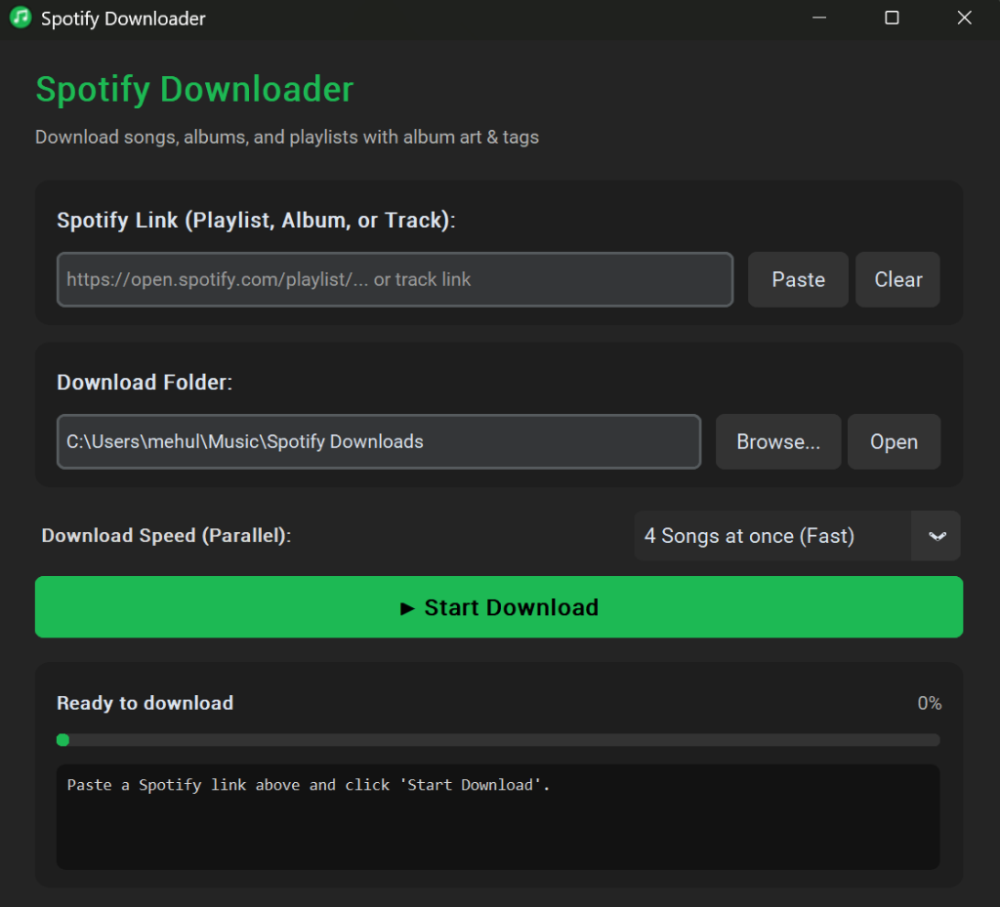

# 🎵 Spotify Downloader

A fast, modern desktop application and CLI that downloads Spotify playlists, albums, or individual tracks — with full ID3 metadata and high-resolution album art embedded.

<p align="center">
  
</p>

---

## ✨ Features

- **Blazing Fast Parallel Downloads**: Download up to 4 or 6 songs at the same time concurrently for up to 5x faster downloads. Configurable in the GUI and CLI.
- **Simple & Clean UI**: Enter or paste a link, pick your folder, choose your download speed, click **Start Download**, and watch real-time progress.
- **Desktop Shortcut**: Double-click the **Spotify Downloader** icon on your Desktop to launch directly without opening a terminal.
- **Unlimited Playlist Length**: Handles playlists with 100, 200, 500+ tracks automatically without capping or truncation.
- **Smart Incremental Sync**: Use the same folder again and again. If your playlist has 150 songs and you add 5 new ones, it skips the 145 existing songs in seconds and downloads only the 5 new ones.
- **Embedded High-Resolution Album Art**: Injects 640×640 album artwork directly into every audio file.
- **Complete ID3 Tags**: Title, Lead Artist, Contributing/Featured Artists, Album, Track Number, Disc Number, and Release Date intact. Widely compatible with Windows Explorer, VLC, iTunes, Apple Music, and mobile players.
- **Zero Configuration**: No Spotify API key, developer account, or login required.

---

## 🖥️ Running the Desktop App

1. **From your Desktop**: Double-click the **Spotify Downloader** shortcut.
2. **From Terminal**:
   ```powershell
   python gui.py
   ```

---

## 💻 Running via Command Line (CLI)

```powershell
# Download a playlist to a folder:
python spotify_dl.py https://open.spotify.com/playlist/<id> -o "C:\Music\MyPlaylist"

# Download with 4 parallel threads (default is 4x speed):
python spotify_dl.py https://open.spotify.com/playlist/<id> -o "C:\Music\MyPlaylist" --threads 4

# Incremental update (skips all existing tracks and downloads only new additions):
python spotify_dl.py https://open.spotify.com/playlist/<id> -o "C:\Music\MyPlaylist"

# Download a single track:
python spotify_dl.py https://open.spotify.com/track/4cOdK2wGLETKBW3PvgPWqT -o "C:\Music"
```

### CLI Options

| Flag | Description | Default |
|------|-------------|---------|
| `-o`, `--output` | Destination folder for downloads | `~/Music/Spotify Downloads` |
| `-t`, `--threads` | Number of parallel song downloads | `4` |
| `--format` | Output audio format (`mp3`, `m4a`, `flac`, `opus`, `wav`) | `mp3` |
| `--bitrate` | Audio bitrate (`128k`, `192k`, `256k`, `320k`) | `320k` |
| `--force` | Re-download songs even if already present | `False` |
| `--limit` | Limit download to first N tracks | `None` (all) |
